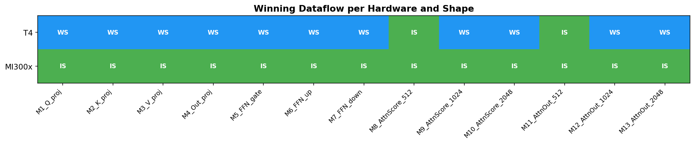
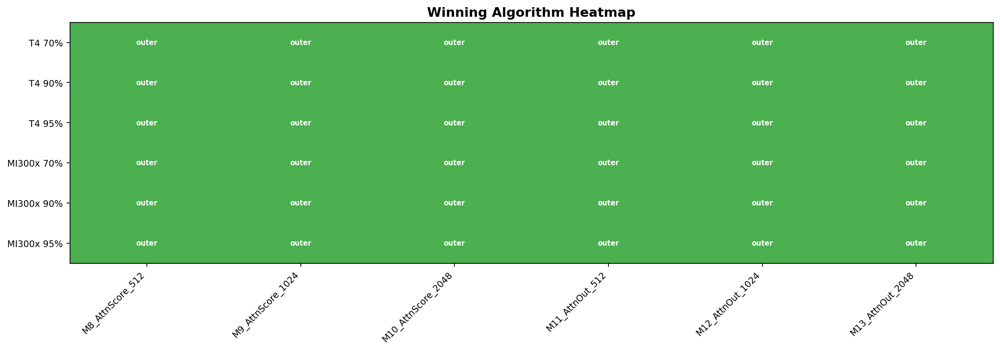

# dataflow-bench

GPU implementation and benchmarking of dense dataflow strategies and sparse SpMSpM algorithms for LLM-scale matrix workloads on NVIDIA T4 and AMD MI300x.

Motivated by dataflow analysis in [LOCAL] and sparse tensor computation in [Maple], this repo implements these ideas directly on GPU hardware using Triton — bridging the gap between algorithmic analysis and real GPU performance.

---

## Key Findings

### Dense Matmul — Dataflow Strategy

78 benchmark data points across 13 LLaMA 1-7B shapes × 3 dataflows × 2 hardware:

- **IS wins on MI300x** — all 13/13 shapes. HBM3 bandwidth absorbs dataflow differences.
- **WS wins on T4** — 11/13 shapes. Bandwidth constraints make weight reuse critical.
- **OS is worst on both** — 3.3x penalty on T4, only 1.26x on MI300x.
- **Dataflow sensitivity**: T4 shows 3x spread between best/worst. MI300x only 1.25x.

→ On MI300x, dataflow choice barely matters. On T4, it matters significantly.



### Sparse SpMSpM — Algorithm Choice

144 benchmark data points across 6 attention shapes × 3 sparsity levels × 4 algorithms × 2 hardware:

- **Outer-product wins universally** — 36/36 cases on both T4 and MI300x.
- **All three Triton algorithms beat vendor** (cuSPARSE/rocSPARSE) — 54/54 cases.
- **Max speedup: 198x** over rocSPARSE on MI300x at 70% sparsity.
- **GPU reverses the CPU algorithm ranking** from [GAMMA] — Gustavson ≈ Inner-product on GPU.
- **MI300x benefits outer-product most** — 4.4x speedup over T4 vs 2.4x for Gustavson.

→ Specialized Triton kernels beat vendor libraries by orders of magnitude for LLM attention sparsity.



---

## Repository Structure

    dataflow-bench/
    ├── workloads/          # LLaMA-7B matrix shape definitions (13 shapes)
    ├── dense/              # Dense matmul dataflow comparison
    │   ├── kernels/        # WS, IS, OS Triton kernels
    │   ├── results/        # T4 and MI300x benchmark CSVs
    │   └── analysis/       # Scripts, 5 figures, report
    └── sparse/             # Sparse SpMSpM algorithm comparison
        ├── sparsity/       # Top-k mask generator, CSR utilities
        ├── algorithms/     # Inner, Outer, Gustavson, Vendor kernels
        ├── results/        # T4 and MI300x benchmark CSVs
        └── analysis/       # Scripts, 5 figures, report

---

## Hardware

| Hardware | Architecture | Memory | Bandwidth |
|---|---|---|---|
| NVIDIA T4 | Turing, Tensor Cores | 16GB GDDR6 | 300 GB/s |
| AMD MI300x | CDNA3, Matrix Cores | 192GB HBM3 | 5.3 TB/s |

---

## Workloads

13 LLaMA-7B matrix shapes:

| Group | Shapes | Size |
|---|---|---|
| Attention projections (Q/K/V/Out) | M1–M4 | 4096×4096×4096 |
| FFN layers (gate/up/down) | M5–M7 | up to 4096×11008×4096 |
| Attention scores Q×Kᵀ | M8–M10 | seq 512/1024/2048 |
| Attention output scores×V | M11–M13 | seq 512/1024/2048 |

---

## Quick Start

```bash
git clone https://github.com/midiareshadi/dataflow-bench.git
cd dataflow-bench
pip install torch triton pandas numpy matplotlib
```

### Dense dataflow benchmark (NVIDIA T4)
```bash
python3 dense/benchmark_t4.py
```

### Dense dataflow benchmark (AMD MI300x)
```bash
pip install torch --index-url https://download.pytorch.org/whl/rocm6.0
python3 dense/benchmark_mi300x.py
```

### Sparse SpMSpM benchmark (NVIDIA T4)
```bash
python3 sparse/benchmark_t4.py
```

### Sparse SpMSpM benchmark (AMD MI300x)
```bash
python3 sparse/benchmark_mi300x.py
```

### Reproduce analysis and figures
```bash
python3 dense/analysis/analyze.py && python3 dense/analysis/plot.py
python3 sparse/analysis/analyze.py && python3 sparse/analysis/plot.py
```

---

## Detailed Results

- Dense dataflow: [dense/analysis/report.md](dense/analysis/report.md)
- Sparse SpMSpM: [sparse/analysis/report.md](sparse/analysis/report.md)

---

## References

- **LOCAL** — Low-Complex Mapping Algorithm for Spatial DNN Accelerators: https://arxiv.org/abs/2211.03672
- **Maple** — Sparse tensor computation: https://arxiv.org/pdf/2303.15199
- **GAMMA** — SpMSpM algorithm comparison (CPU): https://people.csail.mit.edu/sanchez/papers/2021.gamma.asplos.pdf
- **H2O** — LLM attention sparsity: https://arxiv.org/abs/2306.14048
- **Eyeriss** — Energy-Efficient Reconfigurable Accelerator for Deep CNNs: Chen et al., ISCA 2016. https://eems.mit.edu/wp-content/uploads/2016/11/eyeriss_jssc_2017.pdf
- **LLaMA** — Open and Efficient Foundation Language Models: Touvron et al., 2023. https://arxiv.org/abs/2302.13971
- **Triton** — GPU kernel language: https://github.com/openai/triton
