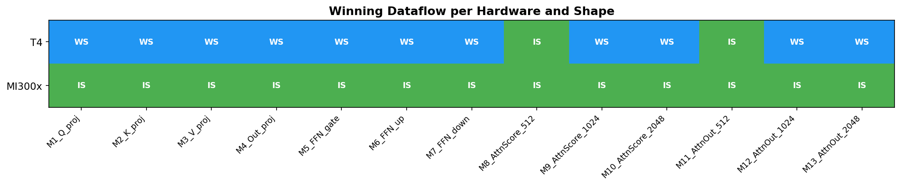
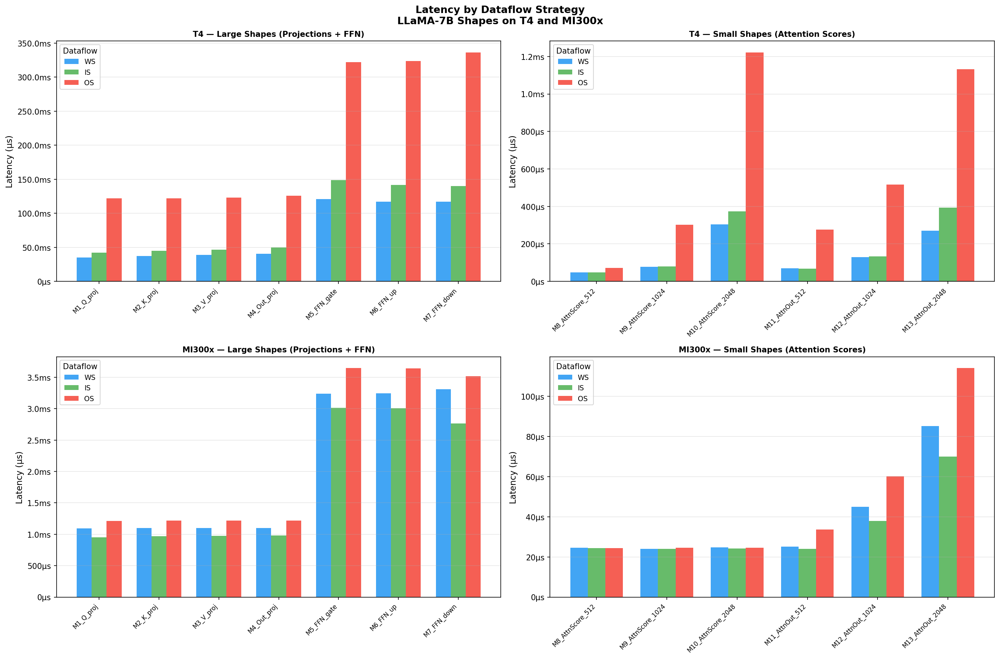
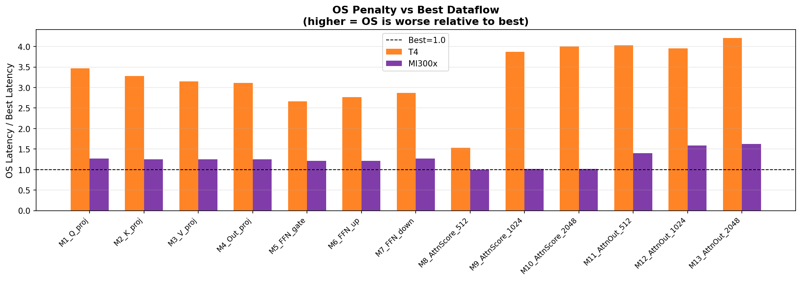
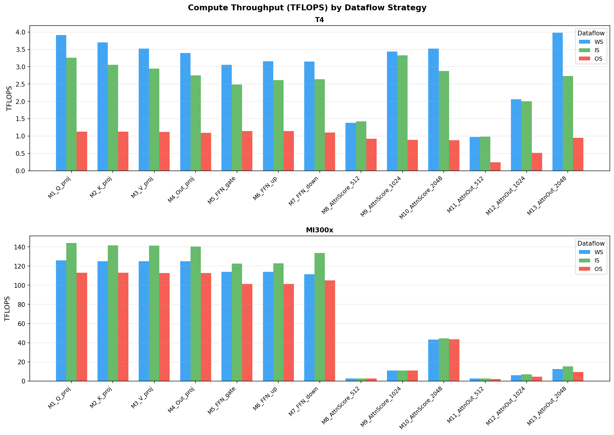

# Dense Dataflow Benchmark

Comparing **Weight Stationary (WS)**, **Input Stationary (IS)**, and **Output Stationary (OS)** dataflow strategies for dense matrix multiplication on NVIDIA T4 and AMD MI300x using LLaMA 1-7B workloads.

---

## Key Findings

1. **Dataflow choice is hardware-dependent, not workload-dependent.**
   WS wins on T4 (11/13 shapes), IS wins on MI300x (13/13 shapes).

2. **OS is consistently the worst strategy on both hardware.**
   T4: 3.30x slower than best. MI300x: only 1.26x slower.

3. **Dataflow sensitivity is hardware-dependent.**
   T4: 3x spread between best/worst. MI300x: only 1.25x spread.

4. **MI300x HBM3 bandwidth absorbs dataflow choice.**
   The massive bandwidth advantage makes dataflow strategy nearly irrelevant on MI300x.

---

## Results

### Winning Dataflow Heatmap


### Latency by Dataflow Strategy


### OS Penalty vs Best Dataflow


### TFLOPS Comparison


---

## Structure

    dense/
    ├── kernels/
    │   ├── matmul_ws.py       # Weight Stationary Triton kernel
    │   ├── matmul_is.py       # Input Stationary Triton kernel
    │   └── matmul_os.py       # Output Stationary Triton kernel
    ├── benchmark_t4.py        # NVIDIA T4 benchmark script
    ├── benchmark_mi300x.py    # AMD MI300x benchmark script
    ├── results/
    │   ├── t4/t4_results.csv        # 39 benchmark data points
    │   └── mi300x/mi300x_results.csv # 39 benchmark data points
    └── analysis/
        ├── analyze.py         # Analysis script (5 research questions)
        ├── plot.py            # Figure generation script
        ├── report.md          # Full written report
        └── figures/           # 5 publication-quality figures

---

## How to Reproduce

### Correctness checks (no GPU needed)
```bash
python3 dense/kernels/matmul_ws.py
python3 dense/kernels/matmul_is.py
python3 dense/kernels/matmul_os.py
```

### NVIDIA T4 (Google Colab GPU runtime)
```bash
pip install triton torch
python3 dense/benchmark_t4.py
```

### AMD MI300x
```bash
pip install torch --index-url https://download.pytorch.org/whl/rocm6.0
pip install triton
python3 dense/benchmark_mi300x.py
```

### Analysis
```bash
pip install pandas numpy matplotlib
python3 dense/analysis/analyze.py
python3 dense/analysis/plot.py
```

---

## Full Report
See [analysis/report.md](analysis/report.md) for complete findings and methodology.
