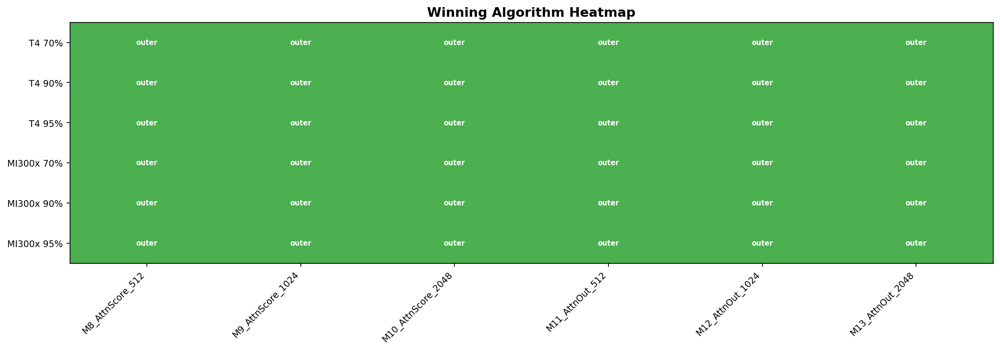
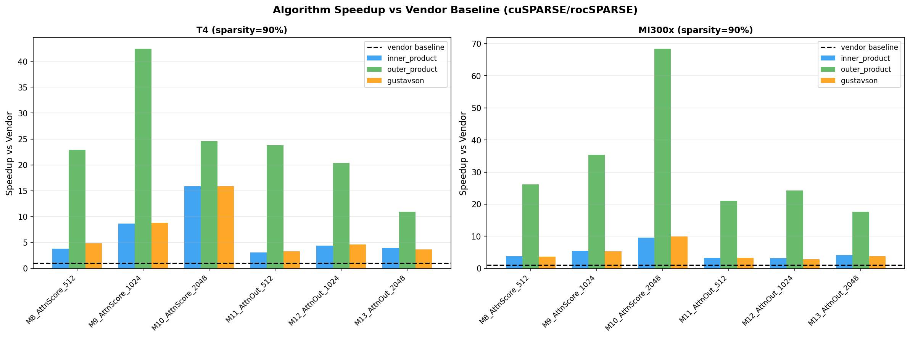
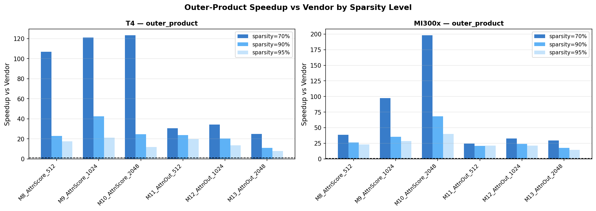
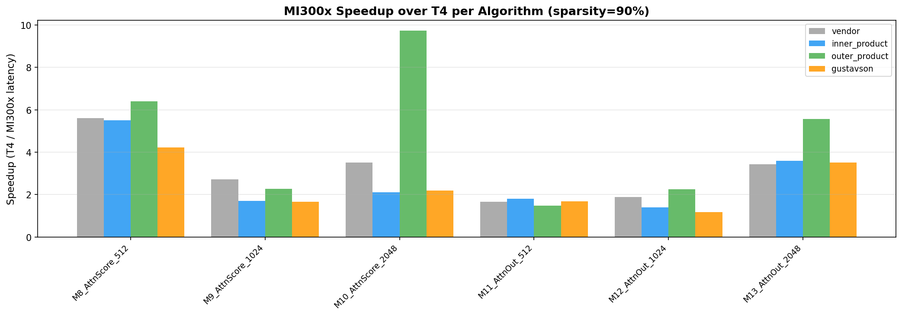
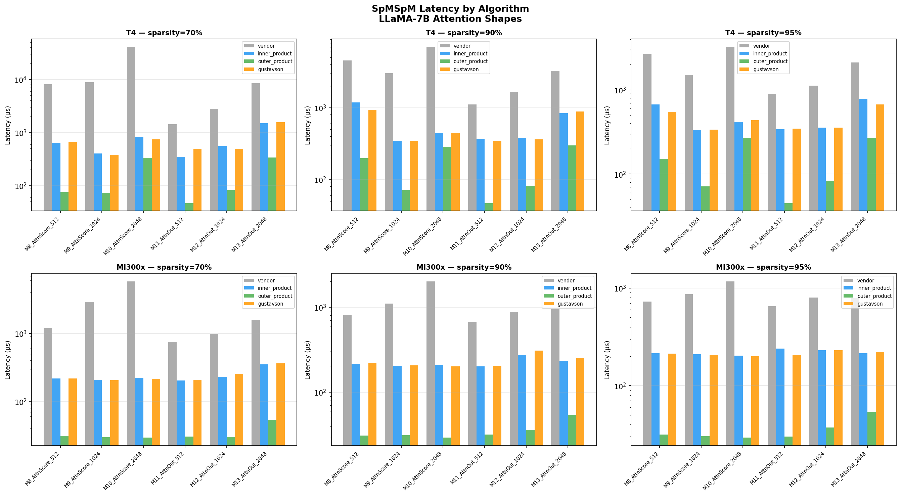
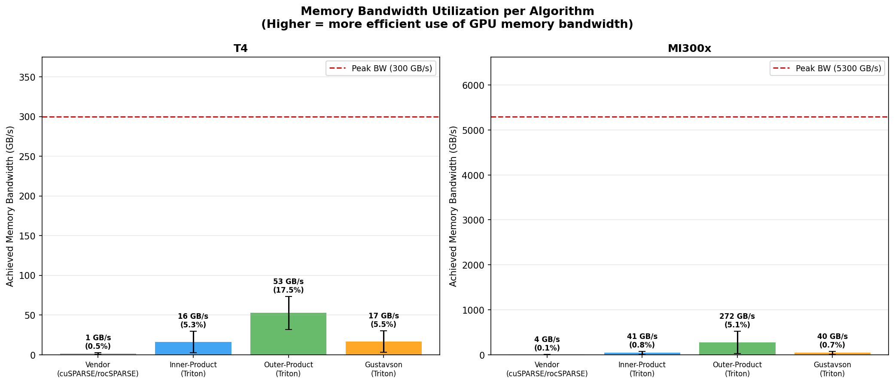
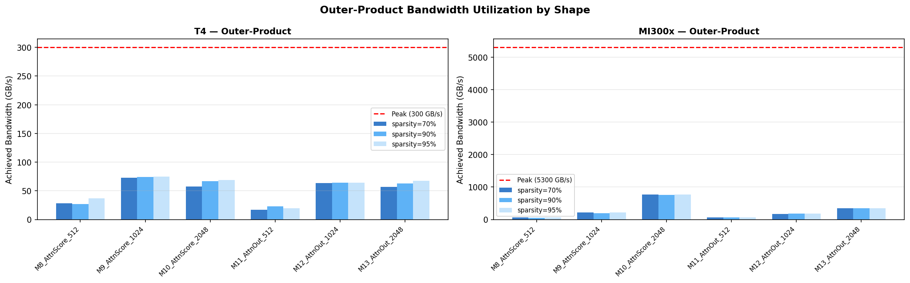

# Sparse SpMSpM Benchmark

Comparing **Inner-Product**, **Outer-Product**, and **Gustavson's** SpMSpM algorithms against vendor-optimized libraries (cuSPARSE/rocSPARSE) using LLM-realistic top-k attention sparsity on NVIDIA T4 and AMD MI300x.

---

## Key Findings

1. **Outer-product wins universally — 36/36 cases on both hardware.**
   Mean speedup: 37.6x over cuSPARSE on T4, 42.4x over rocSPARSE on MI300x.
   Maximum speedup: **198x over rocSPARSE** on MI300x at 70% sparsity.

2. **ALL algorithms beat vendor baseline — 54/54 cases.**
   Specialization for top-k attention sparsity outperforms general-purpose libraries.

3. **Higher sparsity amplifies the advantage.**
   70% sparsity: 73x mean speedup. 95% sparsity: 15x mean speedup.

4. **Inner-product ≈ Gustavson on GPU.**
   Unlike the GAMMA paper where Gustavson wins, GPU hardware makes them equivalent.
   Mean ratio inner/gustavson: 1.03 on T4, 0.99 on MI300x.

5. **MI300x benefits outer-product most (4.4x over T4).**
   Memory-bandwidth-bound outer-product gains most from HBM3.

---

## Results

### Winning Algorithm Heatmap


### Speedup vs Vendor Baseline


### Sparsity Sensitivity


### MI300x vs T4 Speedup


### Latency by Algorithm


---

## Experimental Setup

### Sparsity Pattern
Top-k sparsity per row — LLM-realistic attention pattern:
- **70%** — production-realistic (H2O paper)
- **90%** — long context (SnapKV)
- **95%** — very long context (StreamingLLM)

Top-k sparsity produces uniform row lengths — a key property that enables
efficient Triton tiling with compile-time loop bounds.

### Workloads
6 attention score shapes from LLaMA 1-7B (M8-M13):
- Q×Kᵀ at sequence lengths 512, 1024, 2048
- scores×V at sequence lengths 512, 1024, 2048

### Algorithms

| Algorithm | Strategy | Format |
|---|---|---|
| Vendor (cuSPARSE/rocSPARSE) | Library-optimized | CSR |
| Inner-product | C[i,j] = dot(A[i,:], B[:,j]) | A: CSR, B: dense |
| Outer-product | C += sum_k A[:,k] × B[k,:] | dense tiling + tl.dot |
| Gustavson | Row-wise: C[i,:] += A[i,k]*B[k,:] | A: CSR, B: dense |

---

## Why Outer-Product Wins

The outer-product algorithm maps directly to Tensor Core / Matrix Core operations via `tl.dot()`. It loads regular dense tiles of A and B, accumulating rank-1 updates into the output. Zero columns/rows in sparse A and B contribute nothing naturally.

Inner-product and Gustavson require irregular memory access — gathering specific rows of B indexed by sparse column indices of A — which cannot leverage Tensor Cores as effectively.

**Key insight:** For top-k sparsity, outer-product's regular tiling pattern is more GPU-friendly than inner-product's gather operations, regardless of sparsity level or hardware generation.

---

## Structure

    sparse/
    ├── sparsity/
    │   ├── topk_mask.py         # Top-k sparsity mask generator
    │   └── csr_utils.py         # CSR conversion and validation
    ├── algorithms/
    │   ├── vendor_baseline.py   # cuSPARSE/rocSPARSE baseline
    │   ├── inner_product.py     # Inner-product Triton kernel
    │   ├── outer_product.py     # Outer-product Triton kernel
    │   ├── gustavson.py         # Gustavson PyTorch (Step 1)
    │   └── gustavson_triton.py  # Gustavson Triton kernel (Step 2)
    ├── results/
    │   ├── t4/t4_results.csv          # 72 benchmark data points
    │   └── mi300x/mi300x_results.csv  # 72 benchmark data points
    └── analysis/
        ├── analyze.py           # Analysis script (5 research questions)
        ├── plot.py              # Figure generation script
        ├── report.md            # Full written report
        └── figures/             # 5 publication-quality figures

---

## How to Reproduce

### Correctness checks (no GPU needed)
```bash
python3 sparse/sparsity/topk_mask.py
python3 sparse/sparsity/csr_utils.py
```

### NVIDIA T4 (Google Colab GPU runtime)
```bash
pip install triton torch
python3 sparse/benchmark_t4.py
```

### AMD MI300x
```bash
pip install torch --index-url https://download.pytorch.org/whl/rocm6.0
pip install triton
python3 sparse/benchmark_mi300x.py
```

### Analysis
```bash
pip install pandas numpy matplotlib
python3 sparse/analysis/analyze.py
python3 sparse/analysis/plot.py
```

---

## Comparison with GAMMA Paper

The GAMMA paper compared Inner-product, Outer-product, and Gustavson on CPU for general SpMSpM. Our work extends this to GPU hardware with two key differences:

1. **Algorithm ranking changes on GPU** — Gustavson ≈ Inner-product on GPU (unlike CPU where Gustavson wins)
2. **All algorithms beat vendor libraries** — not shown by GAMMA (CPU-focused)

---

## Bandwidth Utilization Analysis

Measuring achieved memory bandwidth per algorithm explains why outer-product wins:

### Mean Bandwidth Utilization (T4 — peak 300 GB/s)
| Algorithm | Achieved BW | Utilization |
|---|---|---|
| outer_product | 52.54 GB/s | **17.5%** |
| gustavson | 16.57 GB/s | 5.5% |
| inner_product | 15.99 GB/s | 5.3% |
| vendor (cuSPARSE) | 1.36 GB/s | 0.5% |

### Mean Bandwidth Utilization (MI300x — peak 5300 GB/s)
| Algorithm | Achieved BW | Utilization |
|---|---|---|
| outer_product | 272.35 GB/s | **5.1%** |
| inner_product | 40.61 GB/s | 0.8% |
| gustavson | 39.56 GB/s | 0.7% |
| vendor (rocSPARSE) | 3.63 GB/s | 0.1% |

Outer-product achieves **3.3x higher bandwidth than inner/Gustavson** on T4 and **6.7x higher** on MI300x — because `tl.dot()` enables coalesced memory access and Tensor Core utilization. On MI300x, outer-product becomes compute-bound (Tensor Core limited) rather than memory-bound.





### Bandwidth Analysis Scripts
```bash
python3 sparse/analysis/roofline.py      # collect bandwidth data
python3 sparse/analysis/plot_bandwidth.py # generate figures
```

---

## Full Report
See [analysis/report.md](analysis/report.md) for complete findings and methodology.
